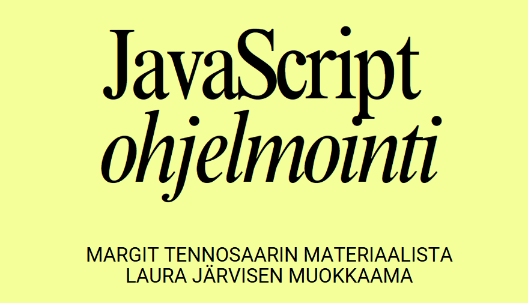



# Ohjelmointi JavaScriptillä

Tervetuloa JavaScript-ohjelmointikurssille!  
Tämä repositorio sisältää kaikki resurssit, lähdekoodin ja kotitehtävät kattavaa JavaScript-ohjelmointikurssiamme varten.

## Johdanto

Tämä repositorio on suunniteltu JavaScript-ohjelmointikurssin tueksi.

**Huomioi**: Kurssin materiaalit mukaanlukien luentodiat löytyy ItsLearningistä. Tämä täydentävä repositorio sisältää:

Koodiesimerkkejä jokaisen viikon aiheista
Viikoittaiset harjoitukset ja tehtävät

## Kurssin sisältö

Kurssimme kattaa laajan valikoiman JavaScriptin aiheita, mukaan lukien:

1. Johdatus JavaScriptiin
2. Perussyntaksi ja operaatiot
3. Ohjausrakenteet (silmukat, ehtolauseet)
4. Funktiot ja näkyvyysalueet
5. Taulukot ja oliot
6. Virheenkäsittely ja debuggaus
7. Asynkroninen JavaScript
8. Johdatus DOM-manipulaatioon
9. JavaScript ja Web API:t

### Linkit teoriaosuuksiin kansioiden sisällä:

- [Muuttujat](01_viikko/01_muuttujat.md)
- [Tietotyypit](01_viikko/02_tietotyypit.md)
- [Numerot](01_viikko/03_numerot.md)
- [Operaattorit](01_viikko/04_operaattorit.md)
- [Merkkijonot](02_viikko/05_merkkijonot.md)
- [Funktioiden perusteet](02_viikko/06_funktioiden_perusteet.md)
- [Ehtolauseet](02_viikko/07_ehtolauseet.md)
- [Muista, kun vertailet...](02_viikko/vertailu.md)
- [Silmukat](03_viikko/silmukat.md)
- [Dom peruskäyttö](03_viikko/dom_peruskäyttö.md)
- [Lomakkeiden käsittely](04_viikko/Lomakkeet.md)
- [Taulukot eli arrayt](05_viikko/taulukot.md)
- [Näkyvyysalue eli scope](05_viikko/näkyvyysalue.md)
- [Oliot eli Objektit](06_viikko/oliot.md)
- [JSON](08_viikko/JSON.md)
- [LocalStorage](08_viikko/LocalStorage.md)
- [JS kirjoitussäännöt](08_viikko/JS_kirjoitussaannot.md)
- [Ketjutus](08_viikko/ketjutus.md)
- [Virheenkäsittely](09_viikko/virheenkasittely.md)
- [Asynkroninen JS koodi](09_viikko/asynkroninen_koodi.md)
- [Fetch ja API](09_viikko/fetch_ja_API.md)
- [Kesätekemistä 2025](Kesä2025/)

## Tehtävät

`harjoitukset`-hakemisto sisältää jokaisen viikon tehtäviin, jotka tulee tehdä viimeistään kotona.
Nämä tehtävät on suunniteltu haastamaan ymmärrystäsi kurssilla käsitellyistä aiheista.  
Käytä niitä taitojesi harjoittamiseen ja vahvistamiseen.

Osaan tehtävistä on esimerkkivastauksia.

### Linkit esimerkkivastauksiin:

- [Viikon 1 harjoitusten vastauksia](01_viikko/02_harjoitukset/esimerkkivastaukset.js)
- [Funktioiden perusteet](02_viikko/harjoitukset/06_funktiot/funktiot_vastaukset.md)
- [DOM peruskäyttö tehtävä 1A,1B ja 1C](03_viikko/harjoitukset/DOM_01/esimerkkivastaukset/)
- [Dom peruskäyttö tehtävät 2-6](04_viikko/harjoitukset/DOM_peruskäyttö/dom_vastaukset/)
- [Pankkiautomaatti-simulaattori](05_viikko/harjoitukset/vastaukset/pankkiautomaatti/)
- [Taulukkotehtävät](05_viikko/harjoitukset/vastaukset/taulukot/)
- [Oliotehtävät 1](06_viikko/harjoitukset/vastaukset/)
- [Oliotehtävät 2 ja 3](07_viikko/harjoitukset/vastaukset//)
- [Pikku eläintarha](08_viikko/harjoitukset/vastaukset/esimerkki_pikkueläintarha/)
- [JSON ja LocalStorage](08_viikko/harjoitukset/vastaukset/)
- [Ketjutus ja JS kirjoitussäännöt](08_viikko/harjoitukset/vastaukset/)
- [Virheenkäsittely](09_viikko/harjoitukset/vastaukset/esim_virheenkasittely.js)
- [Korjaa koodia](09_viikko/harjoitukset/vastaukset/esim_korjaa_koodia.js) (vapaaehtoinen)
- [Asynkroninen koodi](09_viikko/harjoitukset/vastaukset/esim_async.js)

**Pannukakkutilaussivu** on kurssin lopulla arvioitava projekti, joten siitä ei tule esimerkkiratkaisua tänne. Sivu koostuu kolmesta vaiheesta:
- [Pannukakkusivu vaihe 1](04_viikko/harjoitukset/Pannukakkusivu) Pannukakkutyypit, täytteet, lisukkeet ja hinta
- [Pannukakkusivu vaihe 2](06_viikko/pannukakku2) Asiakastiedot ja toimitusvaihtoehdot
- [Pannukakkusivu vaihe 3](09_viikko/pannukakku_3) Tilausten Hallintasivu

## Oppimistavoitteet

Kurssin lopussa sinun tulisi saavuttaa seuraavat oppimistavoitteet:

- JavaScriptin perussyntaksin ja -käsitteiden hallinta
- Taito käsitellä taulukoita, olioita ja asynkronista ohjelmointia
- Kyky manipuloida DOM-rakennetta ja työskennellä Web API:en kanssa
- Virheiden käsittely ja JavaScript-koodin debuggaus
- Käytännön kokemus dynaamisten verkkokäyttöliittymien rakentamisesta

## Päättöprojekti: Pannukakku versio 3

Kurssin aikana työskentelet eri projektien parissa viikoittain, hyödyntäen oppimiasi taitoja.  
Nämä projektit auttavat sinua soveltamaan opittua käytännössä.  
Kurssin lopussa käymme kaikki projektisi yhdessä läpi osana päättöprojektiasi.

### ! Päättöprojektin palaustusohjeet ItsLearningissä

## Lisenssi

Kaikki tämän varaston opetusmateriaalit on lisensoitu GNU Free Documentation License -lisenssillä (GNU FDL).  
Tämä lisenssi myöntää sinulle tiettyjä oikeuksia kunnioittaen tekijän tarkoituksia ja varmistaen, että johdannaisteokset säilyvät avoimina ja vapaasti saatavilla.

**GNU Free Documentation License (GNU FDL)**

Tekijänoikeus (C) Laura Järvinen

Kurssi perustuu [MARGIT TENNOSAARIN](https://github.com/margittennosaar) kurssiin jolle hän on myöntänyt oikeuden kopioida, levittää ja/tai muokata GNU Free Documentation License -lisenssin version 1.3 tai myöhemmän ehtojen mukaisesti, joita Free Software Foundation on julkaissut ilman pysyviä osioita, ilman etu- tai takakannen tekstejä.  
Lisenssin kopio sisältyy osioon nimeltä [GNU Free Documentation License](https://www.gnu.org/licenses/fdl-1.3.txt).

